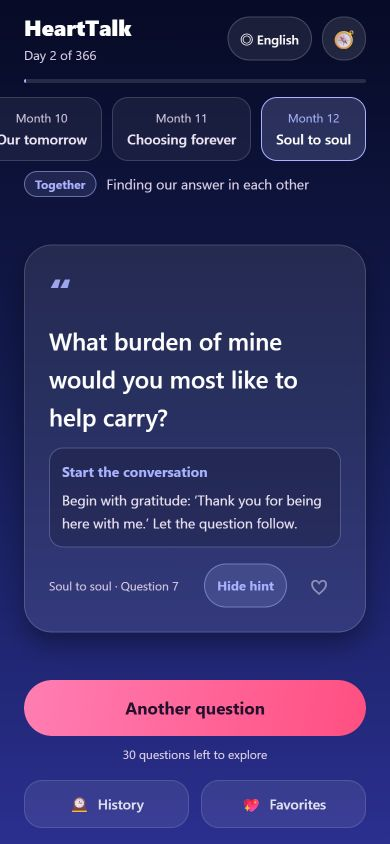

# HeartTalk 💞

[中文](README.md) | **English** | [日本語](README.ja.md) | [한국어](README.ko.md)

[Download the latest Android APK](https://github.com/SAKANA-MOONLIGHT/hearttalk/releases/latest)

Android v1.2.0 uses a new build project and package name, `com.sakanamoonlight.hearttalk`, so it can be installed alongside older versions. History and favorites remain in the old app and are not automatically imported.

A random conversation game for couples and two people getting to know each other: **366 days and 366 unique questions** to help you grow closer.

## Make it easier to keep the conversation going

You want to know someone better, but cannot find a natural way to start. Or you talk every day, yet rarely get beyond “How was your day?” HeartTalk offers a concrete starting point for those moments, giving an everyday conversation a chance to become a deeper understanding of each other.

| Who it is for | What can feel difficult | How HeartTalk can help |
| --- | --- | --- |
| Two people getting to know each other | You want to show interest without awkward silences or making the conversation feel like an interview | Light questions and opening hints give you an easy way in, with room for both people to share their stories |
| Long-term couples | You know each other's routines, but conversations have become daily updates and you rarely hear a new perspective | Questions about memories, feelings, values and future hopes offer chances to discover something you have never discussed |
| Long-distance or busy partners | Time together is limited, and calls can run out of things to say after the schedule updates | Choose one question for your time together, spending less of it searching for a topic and more of it sharing |
| Partners with different ways or paces of opening up | One person wants a deeper conversation while the other is unsure where to begin or is not ready yet | Choose freely from 12 themes and begin with something you both want to discuss, at a pace that feels comfortable |
| Two people who prefer different languages | A good question can still be hard to join in with when its wording is unfamiliar | Switch between Chinese, English, Japanese and Korean to understand the same question in a more familiar language |

**Spend less effort finding something to talk about, and make more room to know each other.** Questions, opening hints, favorites and history help you start and revisit conversations, leaving more attention for responding and listening.

On a date, a walk, a long-distance call or before bed, one question you both want to explore is enough. Use the 366 questions at your own pace: change themes, skip anything you do not feel like answering, or save a question for another day.

## A 366-day conversation journey

- **Month 1, days 1–31:** 31 flirty questions about first impressions, attraction and growing closer.
- **Months 2–12, days 32–366:** 335 questions for couples, with themes that gradually deepen.

| Month | Stage | Theme |
| --- | --- | --- |
| 1 | First sparks | Something between us |
| 2 | Choosing us | From a crush to a couple |
| 3 | Everyday love | Romance in the little things |
| 4 | Little adventures | Try something new together |
| 5 | Memory lane | The lives that led us here |
| 6 | Opening up | A little closer to your heart |
| 7 | Close to you | The sweetness of being near |
| 8 | Understanding us | Finding our way through differences |
| 9 | What matters | Honest talks about real life |
| 10 | Our tomorrow | Dreaming a life together |
| 11 | Choosing forever | Promises we mean to keep |
| 12 | Soul to soul | Finding our answer in each other |

## Features

- 🎯 **Choose freely from 12 themes.** Swipe the theme selector and choose what suits you today. No stages are locked.
- 🎲 Draw a random question from the selected theme, **without repeats**. Previously drawn questions are saved locally.
- 💡 **Conversation starters** accompany every question to help you find a natural opening.
- 📅 Starting your journey records the start date. Your day count follows the calendar, up to 366 days.
- 💖 Save favorite questions and 🕰️ revisit your conversation history.
- 🧭 Open your journey map to see progress and statistics, or select any stage directly.
- 🎨 Each theme has its own gradient colors, with card animations, press feedback and haptics on supported devices.
- 🌐 **中文 / English / 日本語 / 한국어.** The interface, all 366 questions, 12 themes and conversation starters switch together. The first launch uses your device language; a manual choice is saved.
- 📐 **Readable layouts.** Questions and hints are left-aligned; welcome headings and primary buttons are centered. Long text wraps, smaller screens can scroll, and tablet content has a limited reading width.
- ♿ Main controls provide accessibility labels and selection states. Bottom actions stack on narrow screens or with larger system fonts, and repeated draws are blocked while the card animates.

## Language and reading experience

Change the language in the upper-right corner of the welcome or main screen. The choice is saved separately on this device and survives starting a new journey. Unsupported device languages default to English.

Changing language changes the displayed text while keeping question IDs stable. Favorites and history therefore show the corresponding question in your chosen language, with progress preserved. All translations ship with the app; no online translation service is needed at runtime.

The original gradients and romantic mood are retained, with these layout rules:

| Content | Alignment and wrapping |
| --- | --- |
| Welcome headings, tagline, primary buttons and empty states | Centered; multiple lines allowed |
| Questions, hints, history entries and stage descriptions | Left-aligned with comfortable line spacing; no forced single-line truncation |
| Theme selector | Centered labels; scrolls to the measured position of the selected theme |
| Card metadata and actions | Wrap when space is limited; touch targets are at least 44 layout units |

See the [validation record and screenshots](validation/README.md) for the tested scope; the detailed record is currently in Chinese. Android and iOS bundle exports passed. System font scaling, screen readers and haptics still need testing on physical devices.

## Technology

React Native + Expo SDK 56 with TypeScript. **One codebase supports Android and iOS.** A Web preview is also available.

## Run locally

From the repository root:

```bash
npm install
npx expo start
```

- **Android:** install an [Expo Go](https://expo.dev/go) version compatible with SDK 56 and scan the terminal QR code.
- **iOS:** install a compatible Expo Go from the App Store and scan the QR code with your camera. A Mac is not needed for this preview workflow.

## Build an installable app

[EAS Build](https://docs.expo.dev/build/setup/) builds in the cloud, including iOS builds initiated from Windows. Sign in with an Expo account that has access to this project.

```bash
npm install -g eas-cli
eas login
eas build -p android --profile preview
eas build -p ios
```

The configured Android `preview` profile produces an APK. An iOS device build requires the appropriate Apple developer account and signing setup.

To build Android locally, install and configure Android Studio, then run:

```bash
npx expo run:android
```

## Project structure

```text
HeartTalk/
├── App.tsx                   # Welcome, main screen, history, favorites and journey
├── components/
│   └── LanguagePicker.tsx     # Language selection dialog
├── lib/
│   ├── topics.ts             # Original 366 questions and stage/day calculations
│   ├── storage.ts            # Local persistence with ordered writes
│   └── i18n/                 # UI messages, language preference and en/ja/ko content
├── tests/                    # Translation, identity, migration and storage checks
├── validation/               # Test notes and screenshots
└── app.json                  # App name, icons, colors and locale configuration
```

## Customize questions

Edit the monthly `topics` arrays in `lib/topics.ts`, then update the same positions in `lib/i18n/en.json`, `ja.json` and `ko.json`. Monthly counts follow 31/29/31/30/… days, for a total of 366; questions must remain unique.

Question order determines IDs. Avoid reordering published questions, as this would change the meaning of existing history and favorites.

## Validation

```bash
npm test
npm run typecheck
npx expo export --platform all
```

For a Web preview, run `npm run web`. `react-dom` and `react-native-web` are included in versions compatible with Expo SDK 56. Mobile builds continue to use native React Native components.

## Preview


