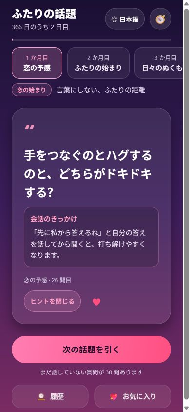

# ふたりの話題 HeartTalk 💞

[中文](README.md) | [English](README.en.md) | **日本語** | [한국어](README.ko.md)

[最新版の Android APK をダウンロード](https://github.com/SAKANA-MOONLIGHT/hearttalk/releases/latest)

恋人同士や、これから距離を縮めたいふたりのためのランダム質問ゲームです。**366 日、重複しない 366 の質問**を通して、お互いを少しずつ知っていきます。

- **1 か月目（1〜31 日目）**：第一印象やときめきについて話す、恋の始まりの 31 問。
- **2〜12 か月目（32〜366 日目）**：恋人同士のための 335 問。テーマごとに、少しずつ深い話へ進みます。

| 月 | ステージ | テーマ |
| --- | --- | --- |
| 1 | 恋の予感 | 言葉にしない、ふたりの距離 |
| 2 | ふたりの始まり | 好きから、恋人へ |
| 3 | 日々のぬくもり | 何気ない毎日にも、ときめきを |
| 4 | 小さな冒険 | 一緒に、新しい楽しみを |
| 5 | 思い出めぐり | 出会う前のあなたを知る |
| 6 | 心をひらく | もっと深く、あなたの心へ |
| 7 | 寄り添うふたり | ときめきが届く距離で |
| 8 | わかり合う | 違いを越えて、近づいていく |
| 9 | 大切な価値観 | 現実のことも、まっすぐに |
| 10 | 未来のふたり | 一緒に描く、これからの暮らし |
| 11 | これからも一緒に | 約束を、日々の選択に |
| 12 | 心の居場所 | お互いが、探していた答え |

## 機能

- 🎯 **12 のテーマを自由に選択**。テーマ一覧を横にスワイプして、その日に話したいものを選べます。ロックはありません。
- 🎲 選んだテーマからランダムに質問を引きます。**同じ質問は出ません**。引いた質問は端末に記録されます。
- 💡 すべての質問に、自然に話し始めるための**会話のきっかけ**を用意しています。
- 📅 旅を始めた日を記録し、実際の日付に合わせて 366 日まで進みます。
- 💖 お気に入りの質問を保存し、🕰️ 履歴からいつでも振り返れます。
- 🧭 「ふたりの歩み」で進捗や統計を確認し、任意のステージを直接選べます。
- 🎨 テーマごとのグラデーション、カードのアニメーション、押したときの反応、対応端末での触覚フィードバック。
- 🌐 **中文 / English / 日本語 / 한국어**。画面、366 問、12 のテーマ、会話のきっかけをまとめて切り替えられます。初回は端末の言語に合わせ、手動で選んだ言語を保存します。
- 📐 **読みやすいレイアウト**。質問とヒントは左揃え、歓迎画面の見出しと主要ボタンは中央揃え。長い文章は折り返し、小さな画面ではページ全体をスクロールできます。タブレットでは本文の幅を制限します。
- ♿ 主な操作に読み上げラベルと選択状態を設定。狭い画面や大きなシステム文字では下部ボタンを縦に並べ、カードのアニメーション中は連続抽選を防ぎます。

## 言語と読みやすさ

歓迎画面、またはメイン画面の右上で言語を変更できます。言語設定はこの端末に個別保存され、最初から始め直しても残ります。未対応の端末言語では English が選ばれます。

言語を変えても質問 ID は変わりません。履歴やお気に入りには、同じ質問が選択した言語で表示され、進捗も保たれます。翻訳はアプリに同梱されており、実行時にオンライン翻訳サービスを使いません。

元のグラデーションと優しい雰囲気を保ちながら、次のルールで配置しています。

| 内容 | 揃え方と折り返し |
| --- | --- |
| 歓迎画面の見出し、標語、主要ボタン、空の状態の案内 | 中央揃え。複数行に対応 |
| 質問、ヒント、履歴の本文、ステージの説明 | 左揃え。行間に余裕を持たせ、強制的な 1 行省略をしない |
| テーマ選択 | ラベルは中央揃え。実測した位置へスクロール |
| カード下部の情報と操作 | 幅が足りなければ折り返し。タッチ領域は最低 44 レイアウト単位 |

確認した範囲とスクリーンショットは[検証記録](validation/README.md)をご覧ください。詳細な記録は現在中国語です。Android/iOS のバンドル出力は成功していますが、システム大文字設定、読み上げ、触覚フィードバックは実機での確認が必要です。

## 技術構成

React Native + Expo SDK 56（TypeScript）。**ひとつのコードベースで Android と iOS に対応**し、Web プレビューも利用できます。

## ローカルで実行する

リポジトリのルートで実行します。

```bash
npm install
npx expo start
```

- **Android**：[Expo Go](https://expo.dev/go) の SDK 56 対応バージョンをインストールし、ターミナルの QR コードを読み取ります。
- **iOS**：App Store から対応する Expo Go をインストールし、カメラで QR コードを読み取ります。このプレビューには Mac は不要です。

## インストール用アプリのビルド

[EAS Build](https://docs.expo.dev/build/setup/) はクラウドでビルドするため、Windows から iOS ビルドを開始することもできます。このプロジェクトへのアクセス権を持つ Expo アカウントでログインしてください。

```bash
npm install -g eas-cli
eas login
eas build -p android --profile preview
eas build -p ios
```

設定済みの Android `preview` プロファイルは APK を生成します。iOS 実機向けのビルドには、適切な Apple 開発者アカウントと署名設定が必要です。

Android をローカルでビルドする場合は、Android Studio をインストール・設定してから実行します。

```bash
npx expo run:android
```

## プロジェクト構成

```text
HeartTalk/
├── App.tsx                   # 歓迎画面、メイン画面、履歴、お気に入り、歩み
├── components/
│   └── LanguagePicker.tsx     # 言語選択ダイアログ
├── lib/
│   ├── topics.ts             # 元の 366 問とステージ・日数の計算
│   ├── storage.ts            # 端末への保存と書き込み順序の管理
│   └── i18n/                 # 画面文言、言語設定、英日韓の翻訳
├── tests/                    # 翻訳、ID、旧データ互換性、保存の確認
├── validation/               # 検証記録とスクリーンショット
└── app.json                  # アプリ名、アイコン、配色、対応言語の設定
```

## 質問をカスタマイズする

`lib/topics.ts` の各月の `topics` 配列を編集し、`lib/i18n/en.json`、`ja.json`、`ko.json` の同じ位置も更新します。月ごとの数は 31/29/31/30/… 日に対応し、合計は 366 問です。質問が重複しないようにしてください。

質問の並び順で ID が決まります。公開済みの質問を並べ替えると、既存の履歴やお気に入りが別の質問を指すため、安易に変更しないでください。

## 検証

```bash
npm test
npm run typecheck
npx expo export --platform all
```

Web プレビューは `npm run web` で起動します。`react-dom` と `react-native-web` は Expo SDK 56 に対応するバージョンを使用しています。モバイル版は引き続き React Native のネイティブコンポーネントで描画します。

## 画面プレビュー


