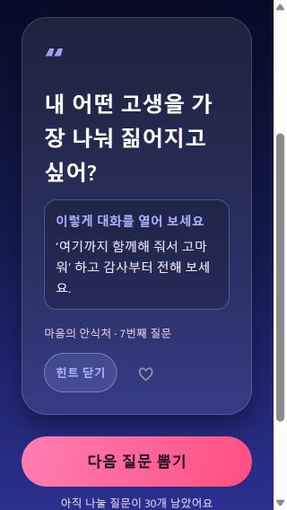

# 우리의 대화 HeartTalk 💞

[中文](README.md) | [English](README.en.md) | [日本語](README.ja.md) | **한국어**

[최신 Android APK 다운로드](https://github.com/SAKANA-MOONLIGHT/hearttalk/releases/latest)

연인이나 서로를 알아가는 두 사람을 위한 랜덤 대화 질문 게임이에요. **366일 동안 중복 없는 질문 366개**로 조금씩 더 가까워져 보세요.

- **1개월째, 1~31일**: 첫인상과 설렘을 나누는 썸 질문 31개.
- **2~12개월째, 32~366일**: 연인을 위한 질문 335개. 테마에 따라 조금씩 깊은 이야기를 나눠요.

| 개월 | 단계 | 테마 |
| --- | --- | --- |
| 1 | 설레는 탐색 | 말하지 않아도 느껴지는 사이 |
| 2 | 마음의 확인 | 좋아하는 사이에서 연인으로 |
| 3 | 다정한 일상 | 평범한 하루에도 로맨스를 |
| 4 | 작은 모험 | 함께 새로운 즐거움을 찾아서 |
| 5 | 추억 여행 | 서로의 지난날 속으로 |
| 6 | 마음을 열다 | 마음 깊은 곳으로 한 걸음 더 |
| 7 | 가까이, 더 가까이 | 설렘이 닿는 거리에서 |
| 8 | 서로 이해하기 | 다름을 넘어 가까워지는 우리 |
| 9 | 소중한 가치관 | 현실에 대해서도 솔직하게 |
| 10 | 우리의 내일 | 함께 그리는 앞으로의 삶 |
| 11 | 오래도록 함께 | 매일의 선택으로 지키는 약속 |
| 12 | 마음의 안식처 | 서로에게서 찾은 우리의 답 |

## 기능

- 🎯 **12가지 테마를 자유롭게 선택**해요. 테마 목록을 옆으로 밀어 오늘 나누고 싶은 주제를 고르세요. 잠긴 단계는 없어요.
- 🎲 선택한 테마에서 **중복 없이** 질문을 무작위로 뽑아요. 뽑은 질문은 기기에 기록돼요.
- 💡 모든 질문에 자연스럽게 대화를 시작할 수 있는 **대화 힌트**가 있어요.
- 📅 여정을 시작한 날짜를 기록하고, 실제 날짜에 따라 최대 366일까지 진행돼요.
- 💖 마음에 드는 질문을 저장하고 🕰️ 대화 기록을 다시 볼 수 있어요.
- 🧭 ‘우리의 여정’에서 진행 상황과 통계를 확인하거나 원하는 단계를 바로 선택해요.
- 🎨 테마별 그라데이션, 카드 애니메이션, 누르기 반응, 지원 기기의 햅틱 피드백을 제공해요.
- 🌐 **中文 / English / 日本語 / 한국어**. 화면, 질문 366개, 테마 12개와 모든 힌트가 함께 바뀌어요. 처음에는 기기 언어를 따르고, 직접 고른 언어는 저장돼요.
- 📐 **읽기 편한 배치**. 질문과 힌트는 왼쪽 정렬, 환영 화면 제목과 주요 버튼은 가운데 정렬이에요. 긴 문장은 줄바꿈되고, 작은 화면은 페이지 전체를 스크롤할 수 있어요. 태블릿에서는 본문 폭을 제한해요.
- ♿ 주요 조작에 읽기 레이블과 선택 상태를 제공해요. 좁은 화면이나 큰 시스템 글꼴에서는 하단 버튼을 세로로 배치하고, 카드 애니메이션 중에는 중복 뽑기를 막아요.

## 언어와 읽기 환경

환영 화면이나 메인 화면의 오른쪽 위에서 언어를 바꿀 수 있어요. 언어 설정은 이 기기에 별도로 저장되며, 여정을 처음부터 다시 시작해도 유지돼요. 지원하지 않는 기기 언어는 English로 표시돼요.

언어를 바꿔도 질문 ID는 유지돼요. 기록과 즐겨찾기는 같은 질문을 선택한 언어로 보여 주며, 진행 상황도 그대로예요. 번역은 앱에 포함되어 있어 실행 중 온라인 번역 서비스가 필요하지 않아요.

기존의 그라데이션과 다정한 분위기를 유지하면서 다음 기준으로 배치했어요.

| 내용 | 정렬과 줄바꿈 |
| --- | --- |
| 환영 화면 제목, 문구, 주요 버튼, 빈 상태 안내 | 가운데 정렬, 여러 줄 허용 |
| 질문, 힌트, 기록 본문, 단계 설명 | 왼쪽 정렬, 여유 있는 줄 간격, 강제 한 줄 말줄임 없음 |
| 테마 선택 | 레이블은 가운데 정렬, 선택한 테마의 실제 위치로 스크롤 |
| 카드 하단 정보와 조작 | 공간이 부족하면 줄바꿈, 터치 영역은 최소 44 레이아웃 단위 |

확인한 범위와 스크린샷은 [검증 기록](validation/README.md)을 참고하세요. 상세 기록은 현재 중국어로 제공돼요. Android/iOS 번들 내보내기는 통과했으며, 시스템 큰 글꼴, 화면 읽기와 햅틱은 실제 기기에서 확인해야 해요.

## 기술 구성

React Native + Expo SDK 56, TypeScript를 사용해요. **하나의 코드베이스로 Android와 iOS를 지원**하며 Web 미리보기도 제공해요.

## 로컬에서 실행하기

저장소 루트에서 실행하세요.

```bash
npm install
npx expo start
```

- **Android**: SDK 56과 호환되는 [Expo Go](https://expo.dev/go)를 설치하고 터미널의 QR 코드를 스캔하세요.
- **iOS**: App Store에서 호환되는 Expo Go를 설치한 뒤 카메라로 QR 코드를 스캔하세요. 이 미리보기에는 Mac이 필요하지 않아요.

## 설치용 앱 빌드

[EAS Build](https://docs.expo.dev/build/setup/)는 클라우드에서 빌드하므로 Windows에서도 iOS 빌드를 시작할 수 있어요. 이 프로젝트에 접근 권한이 있는 Expo 계정으로 로그인하세요.

```bash
npm install -g eas-cli
eas login
eas build -p android --profile preview
eas build -p ios
```

설정된 Android `preview` 프로필은 APK를 생성해요. iOS 실제 기기용 빌드에는 적절한 Apple 개발자 계정과 서명 설정이 필요해요.

Android를 로컬에서 빌드하려면 Android Studio를 설치하고 설정한 뒤 실행하세요.

```bash
npx expo run:android
```

## 프로젝트 구조

```text
HeartTalk/
├── App.tsx                   # 환영 화면, 메인, 기록, 즐겨찾기, 여정
├── components/
│   └── LanguagePicker.tsx     # 언어 선택 창
├── lib/
│   ├── topics.ts             # 원본 질문 366개와 단계·날짜 계산
│   ├── storage.ts            # 기기 저장 및 쓰기 순서 관리
│   └── i18n/                 # 화면 문구, 언어 설정, 영어·일본어·한국어 번역
├── tests/                    # 번역, ID, 이전 데이터 호환성과 저장 검증
├── validation/               # 검증 기록과 스크린샷
└── app.json                  # 앱 이름, 아이콘, 색상과 언어 설정
```

## 질문 수정하기

`lib/topics.ts`에서 각 월의 `topics` 배열을 수정하고, `lib/i18n/en.json`, `ja.json`, `ko.json`의 같은 위치도 함께 수정하세요. 월별 질문 수는 31/29/31/30/…일에 맞춰 총 366개이며, 질문이 중복되지 않아야 해요.

질문의 순서가 ID를 결정해요. 이미 배포된 질문의 순서를 바꾸면 기존 기록과 즐겨찾기가 다른 질문을 가리킬 수 있으므로 주의하세요.

## 검증

```bash
npm test
npm run typecheck
npx expo export --platform all
```

Web 미리보기는 `npm run web`으로 실행해요. `react-dom`과 `react-native-web`은 Expo SDK 56과 호환되는 버전이에요. 모바일 앱은 계속 React Native 네이티브 컴포넌트를 사용해요.

## 화면 미리보기


