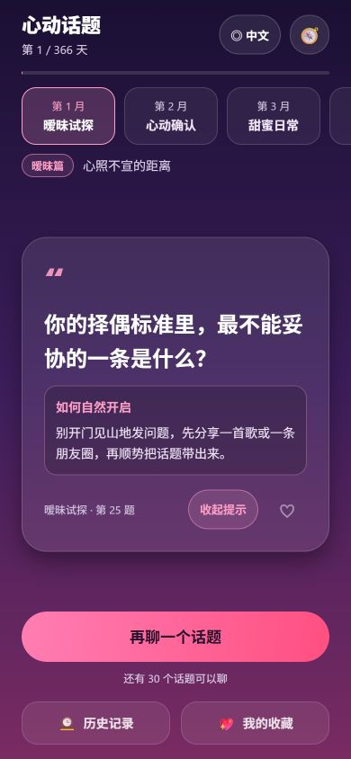

# 心动话题 HeartTalk 💞

**中文** | [English](README.en.md) | [日本語](README.ja.md) | [한국어](README.ko.md)

[下载最新 Android APK](https://github.com/SAKANA-MOONLIGHT/hearttalk/releases/latest)

一款情侣随机话题生成游戏，覆盖 **366 天、366 个不重复话题** 的对话之旅：

- **第 1 个月（第 1~31 天）**：31 个「暧昧篇」话题 —— 试探、心动、心照不宣
- **第 2 ~ 12 个月（第 32~366 天）**：335 个「情侣篇」话题，按月逐步升级：

| 月份 | 阶段 | 主题 |
| --- | --- | --- |
| 1 | 暧昧试探 | 心照不宣的距离（暧昧篇） |
| 2 | 心动确认 | 从喜欢到在一起 |
| 3 | 甜蜜日常 | 柴米油盐皆浪漫 |
| 4 | 趣味探索 | 一起玩点新鲜的 |
| 5 | 回忆时光 | 走进彼此的过去 |
| 6 | 情感升温 | 靠近内心更深处 |
| 7 | 亲密无间 | 心动距离零厘米 |
| 8 | 磨合理解 | 争吵也是种拥抱 |
| 9 | 三观对话 | 认真聊聊现实 |
| 10 | 未来畅想 | 把明天画给你看 |
| 11 | 承诺笃定 | 余生请多指教 |
| 12 | 灵魂相守 | 我们是彼此的答案 |

## 功能

- 🎯 **12 个主题阶段自由切换**：横向滑动主题选择条，想聊哪个聊哪个，无锁定
- 🎲 随机抽取所选主题的话题，**永不重复**（已抽话题持久化记录）
- 💡 **开场提示**：每个话题配「如何自然开启」的建议，不知道怎么开口也不怕
- 📅 首次打开自动记录旅程开始日，按真实日期推进 366 天进度
- 💖 话题收藏 + 🕰️ 抽取历史，随时回看
- 🧭 旅程地图：12 个阶段进度与统计，点击任意阶段直接切换主题
- 🎨 每个主题独立渐变配色、卡片弹出动画、按压反馈与震动
- 🌐 **中文 / English / 日本語 / 한국어**：界面、366 个话题、12 个主题及全部开场提示一起切换；首次跟随设备语言，手动选择后自动保存
- 📐 **更易读的排版**：话题与提示正文左对齐，欢迎标题和主要按钮居中；长文字自然换行，小屏整页可滚动，平板限制正文宽度
- ♿ 主要操作提供朗读标签与选中状态；小屏或较大系统字体下底部操作纵向排列，抽题动画期间防止重复点击

## 语言与阅读体验

欢迎页或主界面右上角可以切换语言。语言偏好单独保存在当前设备，重新开始旅程时也会保留。设备语言暂不支持时默认使用 English。

切换语言只改变显示内容，话题 ID 始终不变。因此，同一个收藏或历史条目会显示所选语言的对应问题，已聊进度也不会重新计算。全部翻译随应用打包，运行时不依赖在线翻译服务。

保留原有主题渐变与心动氛围，采用以下排版规则：

| 内容 | 对齐与换行 |
| --- | --- |
| 欢迎标题、标语、主要按钮、空状态 | 居中，允许多行 |
| 话题正文、开场提示、历史内容、阶段说明 | 左对齐，采用舒适行距，不强制单行省略 |
| 主题选择器 | 居中，按实际位置滚动至所选主题 |
| 卡片底部信息和操作 | 空间不足时自动换行，操作区域至少 44pt |

截图和测试范围见 [验证记录](validation/README.md)。Android/iOS 已通过导出检查，仍需真机检查系统大字体、读屏和触觉反馈。

## 技术栈

React Native + Expo SDK 56（TypeScript），**一套代码同时支持 Android 和 iOS**。

## 本地运行（开发预览）

在仓库根目录执行：

```bash
npm install
npx expo start
```

然后：

- **Android**：手机安装 [Expo Go](https://expo.dev/go)，扫描终端二维码即可运行
- **iOS**：iPhone 安装 Expo Go（App Store），用相机扫码即可运行（无需 Mac）

## 打包安装包

推荐使用 [EAS Build](https://docs.expo.dev/build/setup/)（云端构建，Windows 也能出 iOS 包）：

```bash
npm install -g eas-cli
eas login            # 需要免费的 Expo 账号
eas build -p android --profile preview   # 生成 Android APK
eas build -p ios                         # 生成 iOS 包（需要 Apple 开发者账号）
```

本地构建 Android（需安装 Android Studio）：

```bash
npx expo run:android
```

## 项目结构

```
HeartTalk/
├── App.tsx          # 欢迎页 / 主界面 / 历史收藏 / 旅程地图
├── components/
│   └── LanguagePicker.tsx # 语言选择弹窗
├── lib/
│   ├── topics.ts    # 366 个话题数据 + 月份/阶段计算
│   ├── storage.ts   # 本地持久化及按顺序写入
│   └── i18n/       # 界面文案、语言偏好与 en/ja/ko 完整话题翻译
├── tests/          # 翻译完整性、话题身份、旧数据兼容与存储测试
├── validation/     # 实测说明与截图
└── app.json         # 应用配置（名称、图标、主题色）
```

## 自定义话题

编辑 `lib/topics.ts` 中各月份的 `topics` 数组，并同步更新 `lib/i18n/en.json`、`ja.json`、`ko.json` 的对应位置。每个月的话题数量对应该月天数（31/29/31/30/...），全部话题不能重复。已发布话题的顺序决定 ID，请勿随意重排，以免已有历史和收藏对应到其他问题。

## 验证

```bash
npm test
npm run typecheck
npx expo export --platform all
```

Web 预览使用 `npm run web`。`react-dom` 和 `react-native-web` 已作为 Expo SDK 56 兼容依赖加入；移动端仍使用 React Native 原生组件。

## 界面预览


